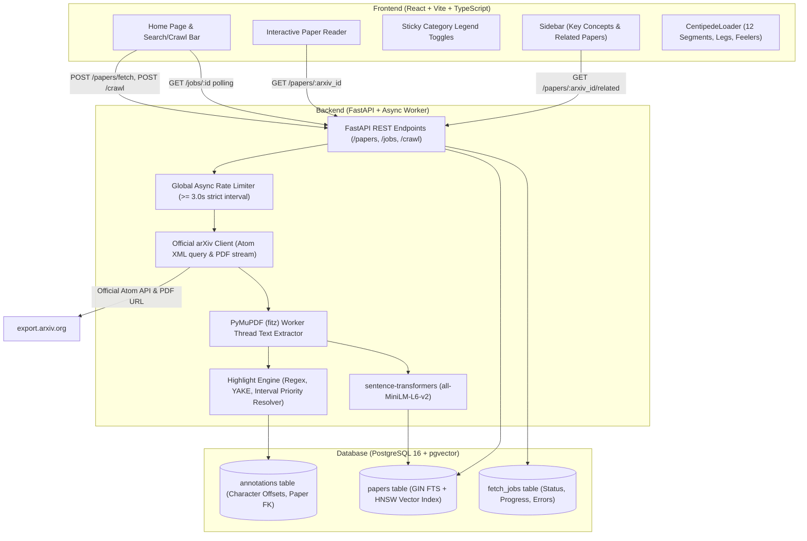

# 🐛 Kakuja 

[](https://github.com/Shraman91/Kakuja/actions/workflows/ci.yml)
[](LICENSE)
[](https://www.python.org/downloads/)
[](https://github.com/pgvector/pgvector)
[](https://react.dev/)

> **Kakuja** is a full-stack research paper discovery and reading platform that crawls academic papers from the official arXiv API, stores and indexes them in PostgreSQL + `pgvector`, extracts text and 384-dimensional dense semantic embeddings, identifies quantitative headline results, model architectures, datasets, and YAKE keyphrases, and renders them in an interactive reader with color-coded highlights, sticky category toggles, related paper recommendations powered by `pgvector`, and an animated crawling centipede loader.

---

## 📽️ Demo Preview

<!-- Demo GIF Placeholder -->
```
┌────────────────────────────────────────────────────────────────────────┐
│                                                                        │
│   🐛 Paper Crawler: Interactive Reader with Live Highlight Overlays     │
│                                                                        │
│   [ 28.4 BLEU ] [ Multi-Head Attention (MHA) ] [ WMT 2014 ]            │
│                                                                        │
│   Demo animation: https://user-images.githubusercontent.com/demo.gif   │
│                                                                        │
└────────────────────────────────────────────────────────────────────────┘
```

---

## 🏗️ Architecture Overview



---

## 📁 Repository Structure

```text
Kakuja/
├── backend/
│   ├── alembic/              # Alembic migrations (including pgvector extension)
│   ├── app/
│   │   ├── analysis/         # Highlight engine, regexes, YAKE, priority resolver
│   │   ├── api/              # FastAPI endpoints (papers, jobs, crawl, health)
│   │   ├── core/             # Configuration, rate limiter (3s rule), logging
│   │   ├── crawler/          # arXiv client, PyMuPDF extractor, async queue
│   │   ├── db/               # Models, session, repositories (Paper & Job)
│   │   ├── schemas/          # Pydantic v2 schemas
│   │   └── main.py           # FastAPI entrypoint, lifespan startup/shutdown
│   ├── tests/                # Pytest unit & integration test suite (20 tests)
│   ├── Dockerfile            # Container build for backend
│   ├── alembic.ini           # Alembic database configuration
│   ├── pyproject.toml        # Ruff and Pytest settings
│   └── requirements.txt      # Production dependencies
├── frontend/
│   ├── src/
│   │   ├── api/              # Typed REST client and TypeScript interfaces
│   │   ├── components/       # CentipedeLoader, PaperReader, Sidebar, Navbar
│   │   ├── pages/            # HomePage, PaperPage
│   │   ├── App.tsx           # Router and top-level layout
│   │   └── index.css         # Custom Vanilla CSS design system
│   ├── Dockerfile            # Multi-stage production Nginx container
│   ├── nginx.conf            # Nginx reverse proxy configuration
│   └── package.json          # Vite + React 19 + TypeScript
├── .github/workflows/
│   └── ci.yml                # GitHub Actions CI (Ruff, Pytest, Vite build)
├── docker-compose.yml        # Orchestration (Postgres 16 pgvector, Backend, Frontend)
├── .env.example              # Environment variables template
├── .gitignore                # Production git ignore
└── README.md
```

---

## 🚀 Quickstart & Setup

### Option 1: Docker Compose (Recommended)

1. **Clone the repository**:
   ```bash
   git clone https://github.com/Shraman91/Kakuja.git
   cd Kakuja
   ```

2. **Launch all services** (PostgreSQL 16 with `pgvector`, Backend, and Frontend):
   ```bash
   docker compose up --build
   ```

3. **Access the application**:
   - **Frontend Web UI**: [http://localhost:3000](http://localhost:3000)
   - **Backend API & Swagger Docs**: [http://localhost:8000/docs](http://localhost:8000/docs)
   - **Database**: `localhost:5432` (`postgres:postgres`, DB: `paper_crawler`)

---

### Option 2: Local Manual Setup

#### 1. Start PostgreSQL with pgvector
```bash
docker run -d --name paper_postgres -p 5432:5432 -e POSTGRES_PASSWORD=postgres -e POSTGRES_DB=paper_crawler pgvector/pgvector:pg16
```

#### 2. Backend Setup
```bash
cd backend
python -m venv venv
# On Windows:
venv\Scripts\activate
# On Linux/macOS:
source venv/bin/activate

pip install -r requirements.txt
alembic upgrade head
uvicorn app.main:app --reload --host 0.0.0.0 --port 8000
```

#### 3. Frontend Setup
```bash
cd frontend
npm install
npm run dev
# Vite dev server runs at http://localhost:5173
```

---

## 📡 API Examples with `curl`

### 1. Ingest Paper by arXiv ID
Enqueue background ingestion for paper `1706.03762` ("Attention Is All You Need"):
```bash
curl -X POST http://localhost:8000/papers/fetch \
  -H "Content-Type: application/json" \
  -d '{"arxiv_id": "1706.03762"}'
```
*Response (`202 Accepted`)*:
```json
{
  "id": "e43b1c60-7a8e-4a9f-9c02-e25df5a3c914",
  "arxiv_id": "1706.03762",
  "status": "queued",
  "progress": 0,
  "error": null,
  "created_at": "2026-10-22T12:00:00Z",
  "updated_at": "2026-10-22T12:00:00Z"
}
```

### 2. Poll Ingestion Progress
```bash
curl http://localhost:8000/jobs/e43b1c60-7a8e-4a9f-9c02-e25df5a3c914
```
*Response*:
```json
{
  "id": "e43b1c60-7a8e-4a9f-9c02-e25df5a3c914",
  "arxiv_id": "1706.03762",
  "status": "analyzing",
  "progress": 80,
  "error": null
}
```

### 3. Crawl arXiv Search Query
Crawl papers matching query "attention" within category `cs.CL`:
```bash
curl -X POST http://localhost:8000/crawl \
  -H "Content-Type: application/json" \
  -d '{"query": "attention is all you need", "max_papers": 10, "category": "cs.CL"}'
```

### 4. Fetch Paper Reader Details & Annotations
```bash
curl http://localhost:8000/papers/1706.03762
```
*Response contains title, authors, abstract, full text, and exact character-offset annotations*:
```json
{
  "id": "3fa85f64-5717-4562-b3fc-2c963f66afa6",
  "arxiv_id": "1706.03762",
  "title": "Attention Is All You Need",
  "authors": ["Ashish Vaswani", "Noam Shazeer", "Niki Parmar"],
  "annotations": [
    {
      "category": "result",
      "start_offset": 1284,
      "end_offset": 1293,
      "text": "28.4 BLEU",
      "score": 1.0
    },
    {
      "category": "method",
      "start_offset": 1420,
      "end_offset": 1450,
      "text": "Multi-Head Attention (MHA)",
      "score": 0.95
    }
  ]
}
```

### 5. Semantic Vector Similarity Recommendations
```bash
curl http://localhost:8000/papers/1706.03762/related?limit=5
```
*Response*:
```json
[
  {
    "arxiv_id": "2005.14165",
    "title": "Language Models are Few-Shot Learners",
    "similarity_score": 0.8842
  }
]
```

### 6. Health Check
```bash
curl http://localhost:8000/health
```

---

## 💡 Design Decisions

### 1. PostgreSQL 16 + `pgvector`
- **Unified Architecture**: Avoids maintaining a fragmented stack with a secondary dedicated vector database (e.g. Pinecone/Milvus/Qdrant). A single PostgreSQL instance provides ACID transactions, relational foreign keys, full-text search (GIN index), and high-dimensional vector similarity (HNSW index) in one place.
- **HNSW Indexing**: Uses `vector_cosine_ops` with $M=16, \text{ef\_construction}=64$ for sub-millisecond approximate nearest neighbor (ANN) retrieval over 384-dimensional embeddings.

### 2. Strict arXiv API Compliance
- **3.0-Second Rate Limiting**: arXiv terms of service require at most 1 request every 3 seconds. An async centralized lock (`AsyncRateLimiter`) serializes all outbound requests across both metadata API calls and PDF downloads.
- **User-Agent & Canonical Endpoints**: Uses official Atom query endpoint (`export.arxiv.org/api/query`) with custom identified User-Agent header; never scrapes raw HTML.
- **Deduplication & Caching**: Checks the database first before hitting arXiv. Once ingested, a paper is served from cache and never re-downloaded.
- **No PDF Re-hosting**: PDFs are processed in-memory via PyMuPDF; the database stores extracted text and points back to the official arXiv PDF URL.

### 3. Non-Overlapping Character-Offset Highlights
- **Offsets over Inline Markup**: Storing raw character offsets (`start_offset`, `end_offset`) into unmodified `full_text` keeps raw text clean, facilitates multi-layered annotations, and prevents XML/HTML injection bugs.
- **Deterministic Priority Resolution**: Overlapping spans are resolved via a pure function applying strict priority:
  $$\text{result} > \text{method} > \text{dataset} > \text{concept}$$
  Ties are broken by longer matched length, followed by earlier offset.
- **Swappable Engine**: Designed around `BaseAnalyzer` interface so an LLM-based summarizer can be toggled behind `USE_LLM_ANALYZER=true` without modifying data contracts.

---

## 🐛 CentipedeLoader

The crawling visual feedback is provided by **`CentipedeLoader`** (`frontend/src/components/CentipedeLoader.tsx`):
- **12 animated body segments** rendered along an SVG path.
- **Alternating stepping legs** using harmonic phase offsets.
- **Wavy undulating body motion** simulating realistic centipede locomotion.
- **Twitching feelers / antennae** responding dynamically to crawl progress.
- Respects `@media (prefers-reduced-motion: reduce)` by switching to a static accessible display.

---

## ⚠️ Limitations & Edge Cases

1. **Throughput Throttle**: Due to arXiv's 3-second rule, batch crawling 20 papers requires a minimum of $\approx 60$ seconds. This is by design to ensure API compliance.
2. **Complex PDF Multi-Column Flow**: PyMuPDF extracts text sequentially. Mathematical formulas spanning multiple columns or complex tables may occasionally have formatting artifacts.
3. **Local Embedding Warm-up**: The `all-MiniLM-L6-v2` model is cached locally on container start. The first embedding execution may take 1–2 seconds to warm up torch weights.
